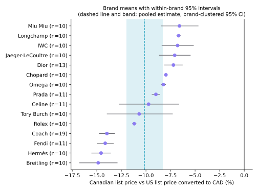
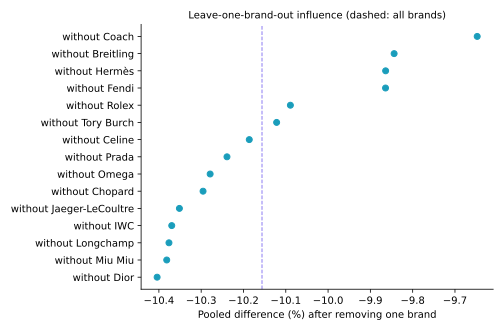
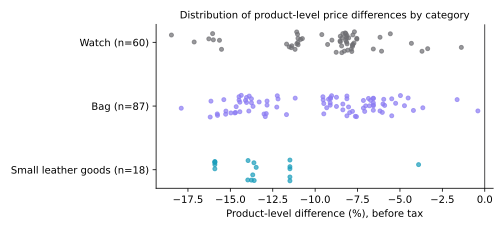
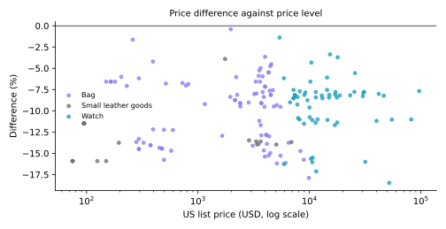
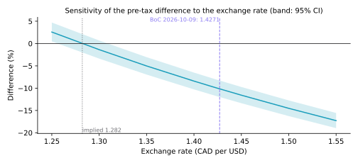

## Abstract

This study compares official list prices for the same products on the US and Canadian websites of 15 luxury and premium brands (165 matched products: handbags, small leather goods and watches), collected on 2026-10-13. For each product, the Canadian price is compared with the US price converted at the Bank of Canada rate of 1.4271 CAD per USD (2026-10-09), before sales tax. The product-weighted mean log difference is −0.107: Canadian list prices are on average 10.2% lower (95% CI −12.0% to −8.3%; t(14) = −11.17, p < 0.001, standard errors clustered by brand). Every one of the 165 products was lower in Canada at this rate. The direction and approximate size hold across alternative weightings, inference methods and sample restrictions (point estimates from −10.2% to −8.9%). Equivalently, the brands' list prices imply about C$1.282 per US dollar. The comparison is descriptive: it measures list-price differences for this set of products on one date and does not identify why brands set prices this way. After an illustrative 13% Ontario HST and 7% US sales tax, the average gap narrows to −5.1%.

## 1. Research question

**Question.** For identical products sold on a brand's official US and Canadian websites, how do Canadian list prices compare with US list prices converted at the market exchange rate?

**Unit and population.** The unit is a product (a style or reference sold in both markets). The target population is products that the selected brands list with a visible price on both their US and Canadian official websites. The sample is not random: brands were included when both sites showed prices that could be read, and products were chosen to cover each brand's core lines (about ten per brand). Results describe this sample; extending them to other brands or products requires assumptions discussed in Section 6.

**Estimand.** For product *i* with US price $P^{US}_i$ (USD) and Canadian price $P^{CA}_i$ (CAD), both before tax, and exchange rate $X$ (CAD per USD),

$$d_i = \ln\!\left(\frac{P^{CA}_i}{X \cdot P^{US}_i}\right), \qquad \theta = E[d_i].$$

$d_i < 0$ means the product is cheaper in Canada after conversion. $\exp(\theta) - 1$ is the geometric-mean percentage difference. Log differences are symmetric, additive across tax and exchange-rate adjustments, and unaffected by the price level, which spans two orders of magnitude here.

**Hypotheses.** $H_0: \theta = 0$ against $H_1: \theta \neq 0$ (two-sided, 5% level).

## 2. Data

Prices were read from each brand's official US and Canadian websites on 2026-10-13, either from the product page or from the brand's category listing page. Each price is stored with its currency, source URL, collection date and a note (`pipeline/collected_prices.csv`). 166 products from 16 brands were listed; 165 from 15 brands have a valid price in both markets and form the analysis sample.

Excluded: Medium Check Tote (burberry): no Canadian price collected.

Categories: Bag 87, Watch 60, Small leather goods 18. Items per brand: 10 to 19.

**Matching and provenance.** Products were matched by the brand's style or reference code where both pages show one. 27 pairs were matched by exact product name because at least one page shows no code, and 2 more have an open identifier check. 104 pairs have at least one price read from a category listing, 11 were shown as sold out (list price still displayed), and 17 repeat an earlier row's brand and exact price pair (often colour variants). These are kept and examined in Section 4.2 rather than removed. Full counts are in `reports/data_quality.md`.

**Exchange rate.** Bank of Canada daily average rate (series FXUSDCAD) for the last business day before collection (2026-10-09, 1.4271); 12 October 2026 was a Canadian holiday. Rates from 2026-09-28 to 2026-10-09 are used for sensitivity.

## 3. Methods

**Estimator.** The sample mean $\bar d$ over matched products.

**Inference.** Prices within a brand are set by one company and move together, so products are not independent. The primary standard error is cluster-robust by brand (CR1), with t critical values on G − 1 = 14 degrees of freedom (Cameron & Miller, 2015). Because 15 clusters is few, a wild cluster bootstrap-t with Rademacher weights and the null imposed is also reported (Cameron, Gelbach & Miller, 2008); with 15 brands all 32768 sign patterns can be enumerated, so no random seed is involved.

**Robustness.** (i) naive paired t-test treating products as independent; (ii) brand cluster bootstrap with percentile interval (B = 9999, seed 20261013; Efron & Tibshirani, 1993); (iii) equal weight per brand; (iv) Wilcoxon signed-rank test (Wilcoxon, 1945); (v) one observation per identical price pair within a brand; (vi) excluding uncertain matches, listing-derived prices, or sold-out items; (vii) leave-one-brand-out and leave-one-product-out influence; (viii) category and tier subsets.

**Regression audit.** OLS of $d_i$ on centred log US price, then adding category indicators, then brand fixed effects, all with brand-clustered CR1 standard errors.

**Scenarios.** Sales tax and the exchange rate multiply every price in a market by the same factor, so each scenario shifts every $d_i$ by the same constant and leaves the standard error unchanged. Tax scenarios use CRA GST/HST rates for Canada (provincial sales taxes in BC, MB, QC and SK are not included) and illustrative combined US rates, since US sales tax varies by state and locality.

## 4. Results

### 4.1 Primary estimate

| Quantity | Value |
|---|---|
| Products (n) | 165 |
| Brands (clusters) | 15 |
| Exchange rate | 1.4271 CAD/USD (2026-10-09) |
| Mean d | −0.1071 |
| SD of d | 0.0419 |
| Clustered SE | 0.0096 |
| 95% CI for mean d | −0.1277 to −0.0865 |
| t (df) | −11.17 (14) |
| p (CR1, t with G−1 df) | < 0.001 |
| p (wild cluster bootstrap-t) | 6.1e-05 (all 32768 Rademacher sign patterns enumerated; this is the smallest p-value attainable with this many clusters) |
| Geometric ratio exp(mean d) | 0.8984 |
| Percentage difference | −10.16% (95% CI −11.99% to −8.29%) |
| Implied exchange rate in list prices | C$1.282 per US$ (95% CI 1.256 to 1.309) |
| Products cheaper in Canada | 165 of 165 |
| Range of product differences | −18.5% to −0.4% (median −9.1%) |

**Interpretation.** At the market exchange rate on the day before collection, a typical product in this sample costs about 10.2% less in Canada than in the US before tax. Put differently, the brands' Canadian prices correspond to roughly C$1.28 per US dollar, while the market rate was C$1.43.



### 4.2 Robustness

| Check | n | Brands | Estimate | 95% CI | p |
|---|---|---|---|---|---|
| Primary: product-weighted mean, brand-clustered CR1 | 165 | 15 | −10.2% | −12.0% to −8.3% | < 0.001 |
| Products treated as independent (naive paired t) | 165 | – | −10.2% | −10.7% to −9.6% | < 0.001 |
| Brand cluster bootstrap, percentile CI | 165 | 15 | −10.2% | −11.7% to −8.6% | – |
| Each brand weighted equally | 165 | 15 | −10.0% | −11.7% to −8.2% | < 0.001 |
| Wilcoxon signed-rank (median) | 165 | – | −9.1% | – | < 0.001 |
| One row per identical (brand, US, CA) price pair | 148 | 15 | −10.0% | −11.8% to −8.2% | < 0.001 |
| Excluding uncertain matches | 137 | 14 | −10.1% | −12.0% to −8.1% | < 0.001 |
| Excluding prices read from category listings | 61 | 13 | −8.9% | −10.8% to −7.0% | < 0.001 |
| Excluding items shown as sold out | 154 | 14 | −9.9% | −11.8% to −7.9% | < 0.001 |

Notes: the Wilcoxon row reports the median, not the mean. The naive interval is about 31% as wide as the clustered one, which shows how much ignoring brand-level dependence would overstate precision. The bootstrap percentile interval with 15 clusters can be too narrow (Cameron, Gelbach & Miller, 2008).

Restricting to prices read from product pages leaves 61 products and gives −8.9%. This subset is not a random part of the sample: 36 of its 61 products are watches and 40 come from Rolex, Longchamp, IWC, Jaeger-LeCoultre, so the difference may partly reflect composition.

**Influence.** Removing one brand at a time moves the estimate between −10.40% (without Dior) and −9.65% (without Coach). No single product changes the mean by more than 0.06 percentage points.



### 4.3 Subsets

| Subset | n | Brands | Estimate | 95% CI |
|---|---|---|---|---|
| Bag | 87 | 9 | −10.0% | −12.4% to −7.6% |
| Small leather goods | 18 | 3 | −13.2% | −16.4% to −9.9% |
| Watch | 60 | 6 | −9.4% | −12.7% to −6.0% |
| Accessible luxury | 39 | 3 | −11.3% | −20.1% to −1.5% |
| Luxury | 66 | 6 | −10.2% | −13.6% to −6.5% |
| Watchmaker | 60 | 6 | −9.4% | −12.7% to −6.0% |

Subsets with few brands have few degrees of freedom and wide intervals; small leather goods come from 3 brands. Brand means range from −14.9% (Breitling) to −6.6% (Miu Miu).



### 4.4 Regression audit

| Model | Term | Coefficient | Clustered SE | p | R² |
|---|---|---|---|---|---|
| d ~ log US price | intercept | −0.1071 | 0.0091 | < 0.001 | 0.02 |
| d ~ log US price | log US price (centred) | 0.0037 | 0.0056 | 0.519 | 0.02 |
| d ~ category + log US price | intercept (Bag) | −0.1067 | 0.0122 | < 0.001 | 0.09 |
| d ~ category + log US price | Small leather goods vs Bag | −0.0381 | 0.0118 | 0.006 | 0.09 |
| d ~ category + log US price | Watch vs Bag | 0.0103 | 0.0222 | 0.649 | 0.09 |
| d ~ category + log US price | log US price (centred) | −0.0015 | 0.0063 | 0.810 | 0.09 |
| d ~ brand fixed effects + log US price (slope only) | log US price (centred) | −0.0042 | 0.0043 | 0.339 | 0.68 |

The log difference is not associated with price level (slope 0.0037 per unit of log price, p = 0.519; within brands −0.0042, p = 0.339). Small leather goods show a larger gap than bags (−0.038, p = 0.006), but they come from only 3 brands, so this contrast is closer to a brand comparison than a category effect. Watches do not differ from bags (p = 0.649).



### 4.5 Exchange-rate and tax scenarios

Over the Bank of Canada rates in the two weeks before collection (1.4168 to 1.4271), the pre-tax estimate ranges from −9.5% to −10.2%. At the implied rate of 1.282 the difference would be zero by construction.



After-tax scenarios (illustrative; the shopper pays the tax of the place of purchase):

| Canadian tax \ US tax | 0% | 4% | 7% | 8.875% | 10.25% |
|---|---|---|---|---|---|
| 5% | −5.7% | −9.3% | −11.8% | −13.4% | −14.4% |
| 13% | 1.5% | −2.4% | −5.1% | −6.8% | −7.9% |
| 14% | 2.4% | −1.5% | −4.3% | −5.9% | −7.1% |
| 15% | 3.3% | −0.7% | −3.4% | −5.1% | −6.3% |

For example, comparing Ontario (13% HST) with a 7% US rate gives −5.1% (95% CI −7.0% to −3.1%). Where Canadian tax is much higher than US tax, the after-tax difference can disappear or reverse.

## 5. Discussion

Across this sample, official Canadian list prices sit below the converted US prices, consistent with brands setting Canadian prices at a rate below the spot exchange rate. The data cannot say why. Possible explanations include list prices being revised less often than the exchange rate moves (Canadian prices may have been set when the Canadian dollar was stronger), different tax and duty treatment, competitive positioning, or deliberate pricing to market; this study does not test any of them. The literature on international price differences documents large border effects (Engel & Rogers, 1996) and studies identical goods sold online across countries (Cavallo, Neiman & Rigobon, 2014).

## 6. Limitations

- **One date.** All prices were read on 2026-10-13; the result is a snapshot and moves with the exchange rate.
- **Selection.** Brands were included only if both official sites showed readable prices, which excludes several major houses (for example Chanel, Louis Vuitton, Gucci and Cartier at collection time). Products were chosen, not sampled at random.
- **List prices, not transaction prices.** Discounts, waiting lists, grey-market premiums and duty or shipping costs are not observed. Several Rolex models in particular trade above list price.
- **Matching.** 27 pairs rely on exact names rather than codes; the estimate without uncertain matches is −10.1%.
- **Few clusters.** 15 brands give 14 degrees of freedom; brand-level conclusions and subset intervals are imprecise.
- **Taxes.** US sales tax varies by state and city and Canadian provincial taxes vary by province; the scenarios are illustrative, and cross-border purchases may owe duty and tax on import.
- **Manual collection.** Prices were read by hand from web pages; source URLs are stored for every price so each can be re-checked.

## 7. Reproducibility

```bash
cd bag-arbitrage/pipeline
pip install -r requirements.txt
python -m unittest discover tests
python run_analysis.py
```

`run_analysis.py` validates the price log, rebuilds the website dataset, runs every analysis in this report and writes `data/results.json`, the tables in `reports/tables/`, the figures in `figures/` and this report. Results were produced with Python 3.13.16, NumPy 2.5.3, pandas 3.0.5 and SciPy 1.18.1. Bootstrap seed 20261013.

## References

- Cameron, A. C., Gelbach, J. B., & Miller, D. L. (2008). Bootstrap-based improvements for inference with clustered errors. *Review of Economics and Statistics*, 90(3), 414–427.
- Cameron, A. C., & Miller, D. L. (2015). A practitioner's guide to cluster-robust inference. *Journal of Human Resources*, 50(2), 317–372.
- Cavallo, A., Neiman, B., & Rigobon, R. (2014). Currency unions, product introductions, and the real exchange rate. *Quarterly Journal of Economics*, 129(2), 529–595.
- Efron, B., & Tibshirani, R. J. (1993). *An Introduction to the Bootstrap*. Chapman & Hall.
- Engel, C., & Rogers, J. H. (1996). How wide is the border? *American Economic Review*, 86(5), 1112–1125.
- Wilcoxon, F. (1945). Individual comparisons by ranking methods. *Biometrics Bulletin*, 1(6), 80–83.
- Bank of Canada. Daily exchange rates, series FXUSDCAD. Valet API, https://www.bankofcanada.ca/valet/observations/FXUSDCAD/json?start_date=2026-09-28&end_date=2026-10-13
- Canada Revenue Agency. GST/HST rates by province. https://www.canada.ca/en/revenue-agency/services/tax/businesses/topics/gst-hst-businesses/charge-collect-which-rate/calculator.html
